# iOS Domain 타입 관계

Domain 모듈은 가입, 공연, 캘린더, 알림 등 업무 영역의 모델과 Repository 계약을 정의한다. 이 문서에서 각 모델이 보유하는 값, Repository의 입력·반환·에러 타입, 업무 영역 사이에서 공유하는 타입을 찾을 수 있다.

[Sources](Sources)에 직접 선언한 타입 98개를 다룬다. 중첩 타입과 타입 별칭도 포함한다. 선은 Domain 내부 타입 사이의 관계를 나타낸다. Swift와 Foundation 타입은 필요한 멤버에 표기한다.

| 업무 영역 | 관계를 볼 수 있는 곳 |
| --- | --- |
| 계정 | [인증과 가입](#인증과-가입), [사용자 프로필](#사용자-프로필) |
| 공연 | [공연 탐색과 상세](#공연-탐색과-상세), [관심 공연](#관심-공연), [공연 요청과 댓글](#공연-요청과-댓글) |
| 일정과 관심사 | [캘린더](#캘린더), [선호 장르와 아티스트](#선호-장르와-아티스트), [알림](#알림) |
| 검색과 공연 콘텐츠 | [검색](#검색), [셋리스트와 곡](#셋리스트와-곡), [페이지네이션](#페이지네이션) |

`-->`는 프로퍼티나 열거형 케이스가 값을 보유하는 관계다. `..>`는 계약, 메서드, 제네릭 사용, 중첩 선언 또는 ID로 연결하는 관계다. `0..1`은 선택 값, `0..*`는 리스트를 뜻한다. 여러 영역에서 쓰는 타입은 관련 다이어그램에 함께 나온다.

## 인증과 가입

`AuthRepository`는 로그인 결과로 `LoginStatus`를 반환한다. 신규 사용자의 `TempUser`를 받아 시작한 `SignupSession`은 약관 동의와 닉네임 확인 상태를 보유한다. 필수 약관과 현재 닉네임 확인을 검증한 뒤 `SignupInfo`를 만든다. [인증과 가입 소스](Sources/Auth)

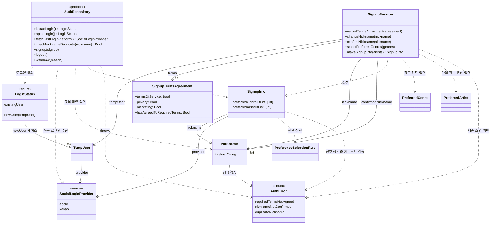

## 사용자 프로필

`UserRepository`는 프로필을 조회·갱신하고 검증된 `Nickname`을 받아 닉네임을 수정한다. 조회한 `User`는 닉네임을 문자열로, 알림 권한과 동의 상태를 `UserAuthority`로 가진다. [사용자 소스](Sources/User)

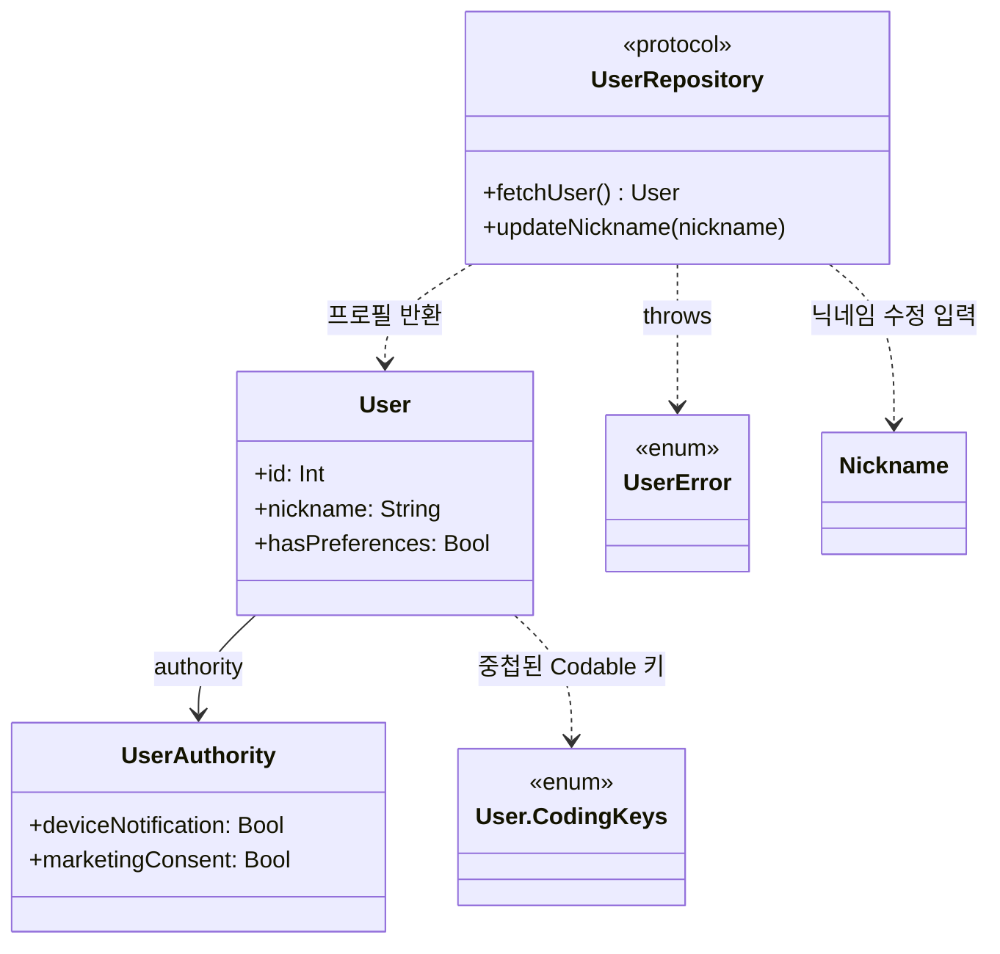

## 공연 탐색과 상세

공연 섹션과 추천 공연은 별도 계약으로 조회하고, 홈 기능이 두 조회 결과를 조합한다. 상세 계약은 공연 ID로 아티스트, 굿즈, 상세 정보, 공연 문화, 일정과 셋리스트를 각각 조회한다. `Concert.artist`에는 아티스트 이름 문자열이 저장된다. [공연 소스](Sources/Concert)

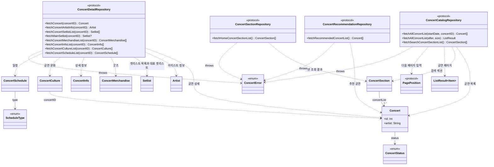

## 관심 공연

`InterestConcert`는 공연과 해당 공연의 예매 일정을 담는다. `InterestConcertSelection`은 현재 선택한 공연 ID와 저장 기준이 되는 ID를 비교한다. 관심 공연 목록과 진입 알림의 계약은 각각 `UserError`를 사용한다. [관심 공연 소스](Sources/Concert/Interest)

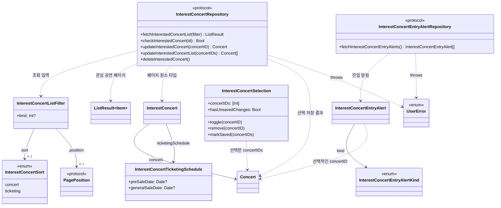

## 공연 요청과 댓글

공연 등록 요청과 댓글 작성은 검증을 거친 입력 타입을 Repository에 전달한다. 공연 매칭은 공유 URL을 받아 공연 목록을 반환한다. 댓글 조회는 댓글 목록과 다음 커서를 튜플로 반환한다. [공연 요청 소스](Sources/Concert/Request) · [공연 댓글 소스](Sources/Concert/Comment)

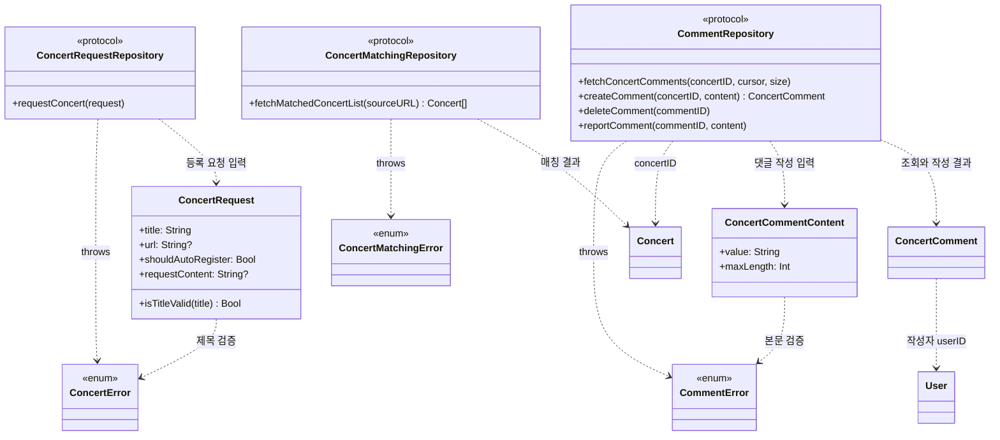

## 캘린더

월 조회는 날짜별 일정 요약을, 날짜 조회는 시간·상태·장소가 포함된 일정을 반환한다. 월별 이벤트와 일별 이벤트는 각자의 이벤트 종류를 `CalendarEventID`의 제네릭 인자로 사용한다. `CalendarScheduleSelection`은 마지막으로 남은 일정 종류를 해제하지 못하게 막는다. [캘린더 소스](Sources/Calendar)

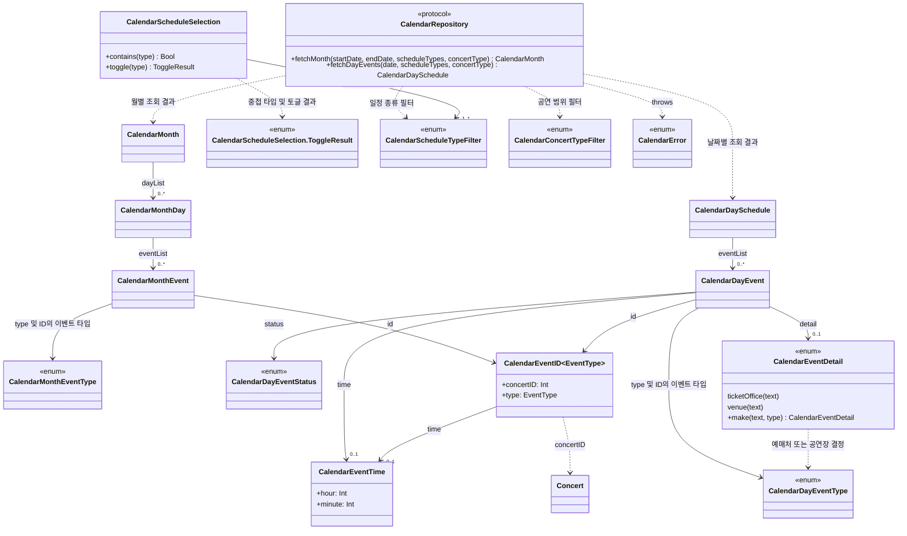

## 선호 장르와 아티스트

`PreferenceRepository`의 아티스트 검색은 `ListResult<PreferredArtist>`를 반환한다.

`PreferenceSelection<Item>`은 장르와 아티스트 선택에 쓰이는 제네릭 모델이다. 선택 상한은 `PreferenceSelectionRule`에 있고, `SignupInfo`도 제출 정보를 만들 때 같은 상한을 적용한다. [선호 소스](Sources/Preference)

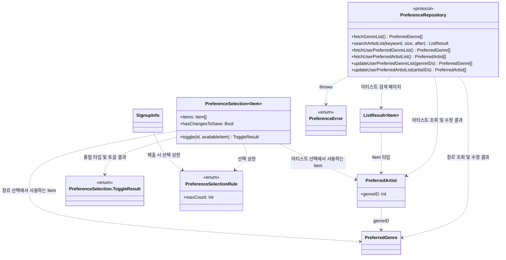

## 알림

알림함은 `NotificationItem`과 읽음 상태를 다룬다. 알림 설정은 동의 항목을 받아 결과를 반환하며, FCM 토큰은 별도 Repository에서 등록·삭제한다. 세 계약은 `NotificationError`를 공유한다. [알림 소스](Sources/Notification)

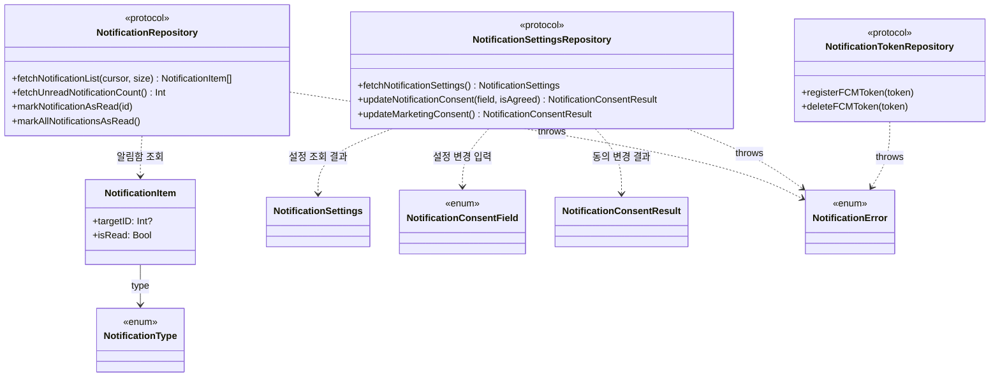

## 검색

`SearchRepository`의 필터 검색은 장르, 정렬, 공연 상태를 입력받는다. 필터 검색은 공연 목록과 이어 조회할 위치를 `ListResult<Concert>`로 반환한다. [검색 소스](Sources/Search)

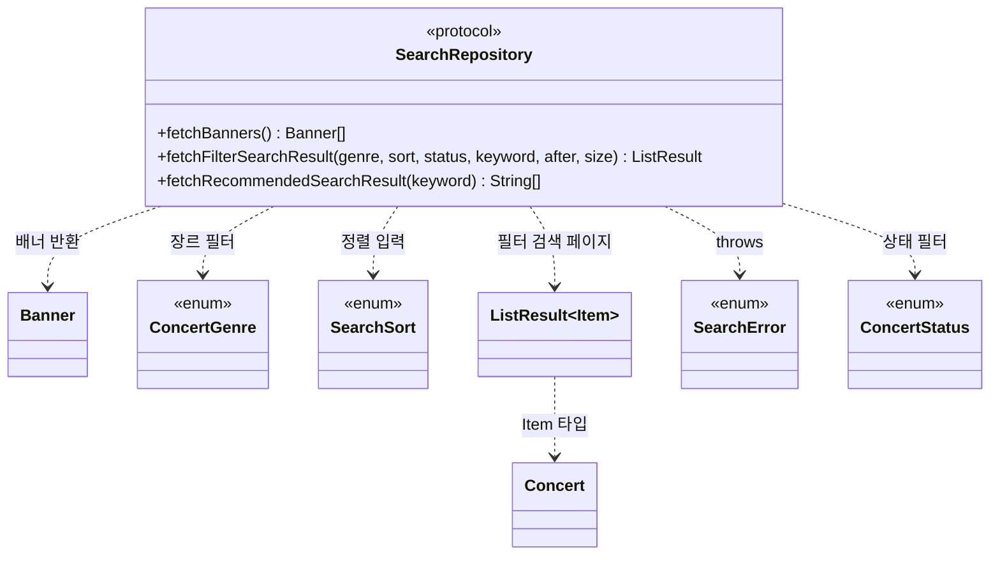

## 셋리스트와 곡

`SetlistRepository`는 셋리스트 상세와 곡 목록을 각각 반환한다. `SongRepository`는 곡 ID로 가사를 조회하고, 셋리스트 ID와 곡 ID를 함께 받아 응원법을 반환한다. [셋리스트 소스](Sources/Setlist) · [곡 소스](Sources/Song)

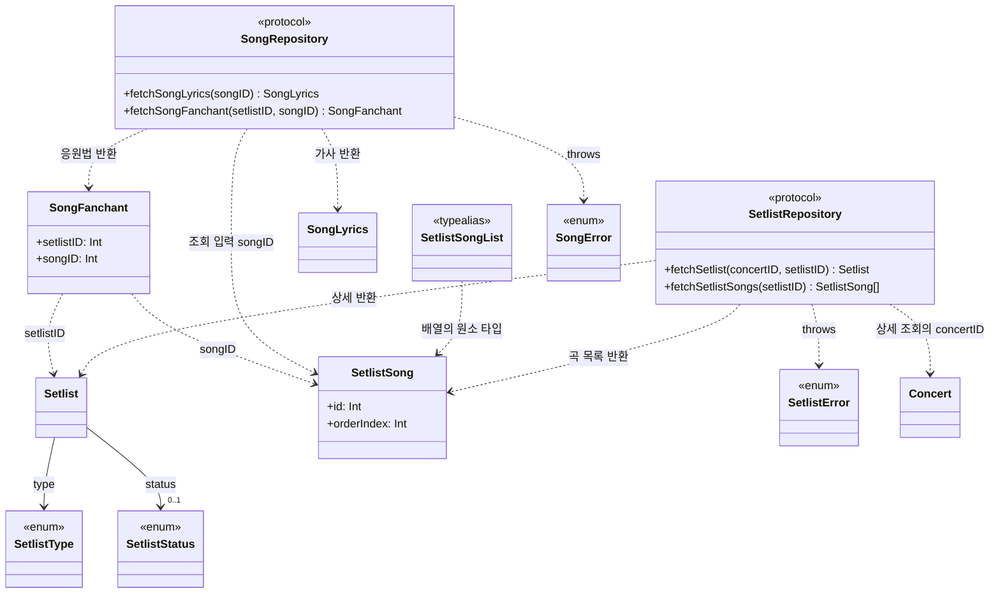

## 페이지네이션

`ListResult<Item>`은 원소 목록과 이어 조회할 위치(`PagePosition?`)를 담는다. 전체 공연 조회와 필터 검색은 `Concert`, 관심 공연 조회는 `InterestConcert`, 아티스트 검색은 `PreferredArtist`를 원소 타입으로 사용한다. [페이지네이션 소스](Sources/Pagination)

검색을 시작하거나 조건을 바꿀 때는 Repository의 `after`에 `nil`을 전달한다. 같은 조건의 다음 페이지는 응답의 `position`을 `after`에 전달해서 조회한다. Data는 서버 커서와 조회 위치를 서로 변환한다. `position`이 `nil`이면 더 조회할 페이지가 없다.

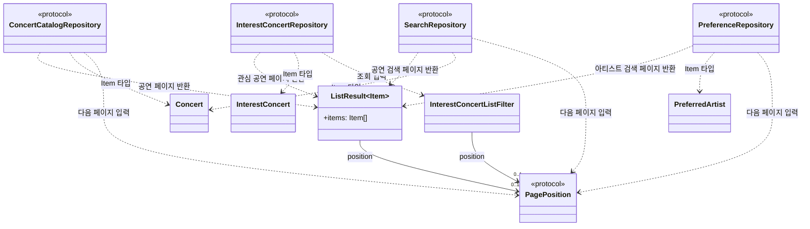
